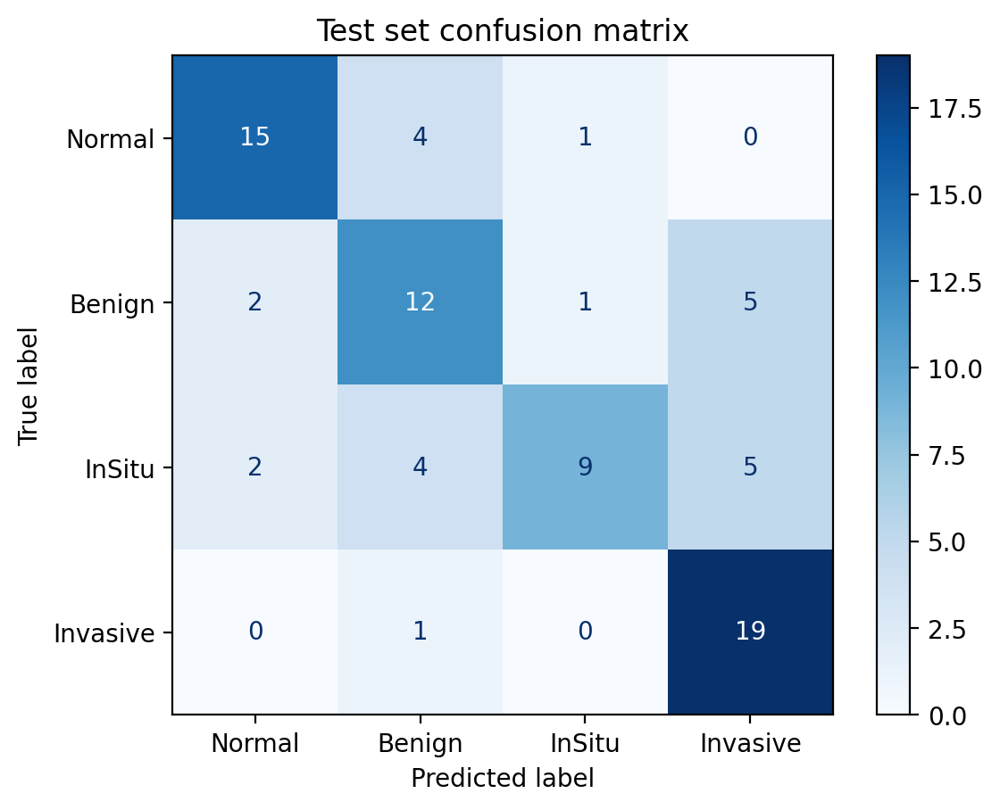

# PhytopathAI

Breast histology classification with visual explanations, lesion clustering, and a literature map of plant compounds studied against each lesion type. From the BSc thesis *A Hybrid Deep Learning Approach for Breast Tumor Classification and Phytochemical Recommendation*.

**Live app:** https://phytopathai.streamlit.app/

**Research prototype. Not a medical device. Nothing here is diagnosis or treatment advice.**

## What it does

1. **Classifies** an H&E breast histology image as normal, benign, in situ carcinoma or invasive carcinoma (VGG16, transfer learning).
2. **Explains** the prediction with Grad-CAM, plus SHAP on request, showing which tissue regions drove the decision.
3. **Clusters** lesion images (ResNet50 features + K-Means) into an early-lesion group and an invasive-enriched group.
4. **Lists plant compounds** with published laboratory evidence against that lesion type, each with its mechanism, evidence tier and PubMed source.

## Results (rebuilt November 2026)

Data: [BACH 2018](https://iciar2018-challenge.grand-challenge.org/) microscopy set, 400 images, 100 per class. Split: 272 training, 48 validation, 80 test. The test images were used once, after every choice had been made on the validation set.

| | Original thesis run | This rebuild |
|---|---|---|
| Test accuracy | 78.75% | **68.75%** (95% CI 58.8–78.8%) |
| Macro F1 | 0.79 | **0.68** |
| Matthews correlation | not reported | 0.59 |
| VGG16 input preprocessing | missing | applied |
| Best epoch chosen on | **test set** | validation set |

The original number was higher because the best training epoch was picked by looking at test accuracy, which leaks the test set into model selection. The rebuilt figure is lower but is an honest estimate.

| Class (20 test images each) | Precision | Recall |
|---|---|---|
| Normal | 0.79 | 0.75 |
| Benign | 0.57 | 0.60 |
| In situ | 0.82 | **0.45** |
| Invasive | 0.66 | **0.95** |

Invasive carcinoma is found almost every time; in situ carcinoma is the hardest class and is often called invasive or benign.



### Lesion clusters

ResNet50 features of the 300 benign, in situ and invasive images (210 to fit, 90 held out), scaled and grouped with K-Means, k = 2.

| | Training | Held out |
|---|---|---|
| Silhouette | 0.11 | 0.10 |
| Chi-square vs diagnosis | p = 5×10⁻¹⁵ | p = 2×10⁻⁶ |

The silhouette is low: the two groups overlap heavily. They still line up with diagnosis. Cluster 1 holds 66 of the 70 training invasive images; cluster 0 is mostly benign and in situ. In effect the clustering separates *invasive* from *early lesions*, which is less than the "biological subtypes" the thesis described.


### Plant compounds

`data/phytochemical_db_v2.csv` holds 8 compounds, each with its mechanism, evidence tier (A: cell and animal studies; B: cell studies only) and a PubMed link. The compounds are linked to a cluster by published mechanism (anti-invasive vs early-stage hormonal action), not learned from this model's data. The original thesis citations were replaced because they did not point to the studies they were cited for.

## Interpretability

- **Grad-CAM** on VGG16's last convolution layer. It is fast and shown for every image.
- **SHAP** with a blurring image masker, on request. It is slower but model-agnostic, so it gives an independent check.

Both work on the 224×224 input, so they highlight regions of tissue, not individual cells.

## Input check

A classifier always answers with one of its classes, even for a photo of a cat. Before analysing, the app checks that an upload looks like H&E histology: at least 35% pink/purple stain, at most 10% green/blue, at least 20% non-background, and fine texture throughout. On 13 histology images and 36 ordinary images (photos, thumbnails, slides, screenshots) it accepted all 13 and refused all 36. It is a heuristic, so the app offers an "analyse anyway" option for unusually pale real slides.

## Limitations

- 400 images from one dataset, with no external validation.
- Whole images are shrunk from 2048×1536 to 224×224, losing cell-level detail. Patch-based training is the obvious next step.
- No pathologist reviewed the clusters or the explanation maps.
- Compound links summarise laboratory studies. They are not evidence that any compound helps patients.

## Repository

| Path | Contents |
|---|---|
| `notebooks/phytopathai_pipeline.ipynb` | The full pipeline (Colab, T4 GPU): data split, training, evaluation, clustering, morphology, compound mapping, app export |
| `notebooks/original_2025/` | The original thesis notebooks, kept for comparison |
| `results/` | Every number and figure above, written by the pipeline |
| `data/phytochemical_db_v2.csv` | Compound evidence table |
| `phytopathai_core.py`, `streamlit_app.py` | The app |
| `app/cluster_params.npz` | Cluster centres and feature scaling used by the app |

The trained classifier weights (half precision, 39 MB; same test predictions as full precision) are downloaded from Google Drive when the app starts.

## Run it

```bash
pip install -r requirements.txt
streamlit run streamlit_app.py
```

To retrain, open `notebooks/phytopathai_pipeline.ipynb` in Google Colab with a T4 GPU and the BACH images in `MyDrive/BreastCancerProject/Train/{Normal,Benign,InSitu,Invasive}/`.

## References

1. Aresta G, et al. BACH: Grand challenge on breast cancer histology images. *Medical Image Analysis* 2019;56:122–139.
2. Simonyan K, Zisserman A. Very deep convolutional networks for large-scale image recognition. *ICLR* 2015.
3. He K, et al. Deep residual learning for image recognition. *CVPR* 2016.
4. Selvaraju RR, et al. Grad-CAM: Visual explanations from deep networks via gradient-based localization. *ICCV* 2017.
5. Lundberg SM, Lee S-I. A unified approach to interpreting model predictions. *NeurIPS* 2017.

## License

Code: Apache 2.0 (see `LICENSE`). The BACH images are not included; see the dataset's own terms.
