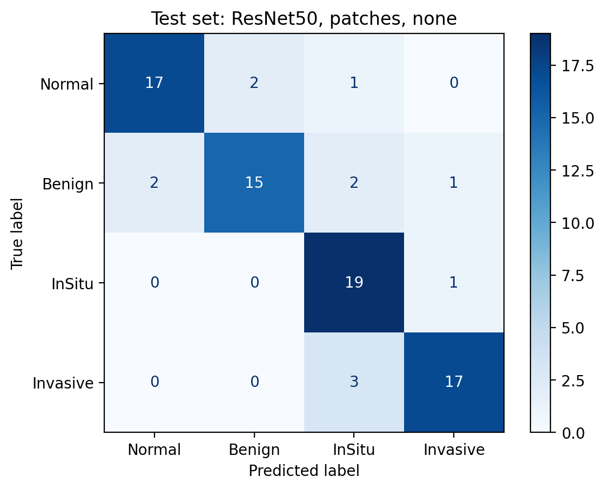
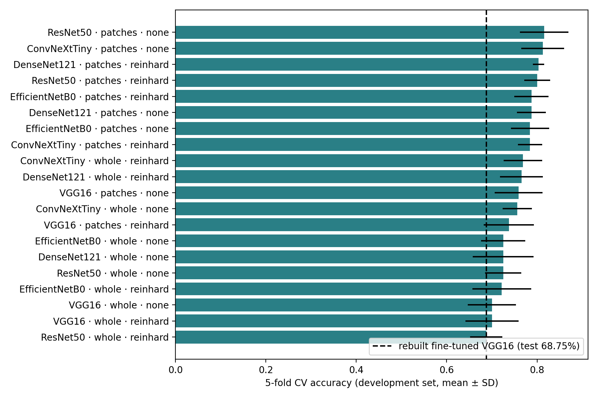
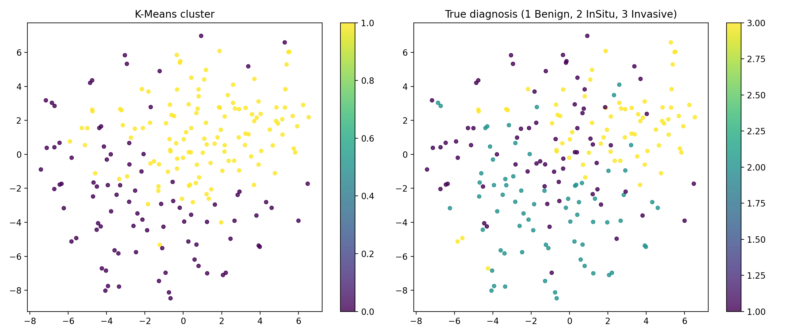

# PhytopathAI

Breast histology classification with visual explanations, lesion clustering, and a literature map of plant compounds studied against each lesion type. From the BSc thesis *A Hybrid Deep Learning Approach for Breast Tumor Classification and Phytochemical Recommendation*.

**Live app:** https://phytopathai.streamlit.app/

**Research prototype. Not a medical device. Nothing here is diagnosis or treatment advice.**

## What it does

1. **Checks** the upload looks like H&E histology, and refuses anything else.
2. **Classifies** it as normal, benign, in situ carcinoma or invasive carcinoma (ResNet50 features from 12 higher-resolution patches + logistic regression; 85.0% on held-out test images).
3. **Explains** the prediction exactly: a class activation map and a SHAP value for each patch.
4. **Clusters** lesion images (ResNet50 features + K-Means) into an early-lesion group and an invasive-enriched group.
5. **Lists plant compounds** with published laboratory evidence against that lesion type, each with its mechanism, evidence tier and PubMed source.

## Results (November 2026)

Data: [BACH 2018](https://iciar2018-challenge.grand-challenge.org/) microscopy set, 400 images, 100 per class. The same 80 images (20 per class) are the test set throughout, used once per model after every choice was made.

### Selected model: patches + ResNet50 + logistic regression

Chosen from 20 candidates by 5-fold cross-validation on the other 320 images, following a protocol written before any result was seen (`notebooks/phytopathai_experiments.ipynb`).

| | Fine-tuned VGG16, whole image | **ResNet50, 12 patches** |
|---|---|---|
| Test accuracy | 68.75% (95% CI 58.8–78.8%) | **85.0%** (95% CI 76.3–92.5%) |
| Macro F1 | 0.68 | **0.85** |
| Matthews correlation | 0.59 | **0.80** |
| In situ recall | 0.45 | **0.95** |
| Cross-validation accuracy | — | 81.6% ± 5.4% |

On the same 80 test images the patch model corrected 19 of the earlier model's errors and introduced 6 new ones (exact McNemar p = 0.015).

| Class (20 test images each) | Precision | Recall |
|---|---|---|
| Normal | 0.89 | 0.85 |
| Benign | 0.88 | 0.75 |
| In situ | 0.76 | 0.95 |
| Invasive | 0.89 | 0.85 |



**What made the difference.** Every network did better on 12 patches from the half-resolution image than on the whole image shrunk to 224×224: by 6 to 9 points without stain normalisation, and 2 to 11 points with it. Network size did not: DenseNet121 (7 M parameters) reached 80.3% in cross-validation against 81.6% for ResNet50 (23.6 M) and 81.2% for ConvNeXt-Tiny (27.8 M), and VGG16 (14.7 M) was the weakest. On patches, Reinhard stain normalisation helped the two smallest networks slightly and hurt the three larger ones. ResNet50 and ConvNeXt-Tiny are within noise of each other; ResNet50 was selected because the protocol said to take the top cross-validation score. The test score (85.0%) is above the cross-validation estimate (81.6%), so part of it is a favourable test set.



### Earlier model and the leakage fix

The thesis's original fine-tuned VGG16 reported 78.75%, but it picked its best training epoch by looking at test accuracy and skipped VGG16's input preprocessing. Rebuilt correctly (272 training, 48 validation, 80 test), it scores 68.75%:

| | Original thesis run | This rebuild |
|---|---|---|
| Test accuracy | 78.75% | **68.75%** (95% CI 58.8–78.8%) |
| Macro F1 | 0.79 | **0.68** |
| Matthews correlation | not reported | 0.59 |
| VGG16 input preprocessing | missing | applied |
| Best epoch chosen on | **test set** | validation set |

The original number was higher because the best training epoch was picked by looking at test accuracy, which leaks the test set into model selection. The rebuilt figure is lower but is an honest estimate.

The earlier model's results are in `results/` and its pipeline in `notebooks/phytopathai_pipeline.ipynb`.

### Lesion clusters

ResNet50 features of the 300 benign, in situ and invasive images (210 to fit, 90 held out), scaled and grouped with K-Means, k = 2.

| | Training | Held out |
|---|---|---|
| Silhouette | 0.11 | 0.10 |
| Chi-square vs diagnosis | p = 5×10⁻¹⁵ | p = 2×10⁻⁶ |

The silhouette is low: the two groups overlap heavily. They still line up with diagnosis. Cluster 1 holds 66 of the 70 training invasive images; cluster 0 is mostly benign and in situ. In effect the clustering separates *invasive* from *early lesions*, which is less than the "biological subtypes" the thesis described.



### Plant compounds

`data/phytochemical_db_v2.csv` holds 8 compounds, each with its mechanism, evidence tier (A: cell and animal studies; B: cell studies only) and a PubMed link. The compounds are linked to a cluster by published mechanism (anti-invasive vs early-stage hormonal action), not learned from this model's data. The original thesis citations were replaced because they did not point to the studies they were cited for.

## Interpretability

The classifier is linear in the averaged ResNet50 features, so both explanations are exact rather than approximated:

- **Class activation map.** Each patch's 7×7 ResNet50 feature map is multiplied by the class weights, showing where inside the patch the evidence sits.
- **SHAP value per patch.** With the training mean as the baseline, the Shapley value of patch *p* for class *c* is ⅟₁₂ · w_c · (f_p − mean). The 12 values add up exactly to the class score, so no sampling is needed.

Each patch covers about 448×448 pixels of the original 2048×1536 image, so the maps point to regions of tissue, not individual cells.

## Input check

A classifier always answers with one of its classes, even for a photo of a cat. Before analysing, the app checks that an upload looks like H&E histology: at least 35% pink/purple stain, at most 10% green/blue, at least 20% non-background, and fine texture throughout. On 13 histology images and 36 ordinary images (photos, thumbnails, slides, screenshots) it accepted all 13 and refused all 36. It is a heuristic, so the app offers an "analyse anyway" option for unusually pale real slides.

## Limitations

- 400 images from one dataset, with no external validation.
- Patches come from a half-resolution image and only the central 3×4 grid is used; full-resolution patches and fine-tuning are untested.
- The network is frozen ImageNet ResNet50; a pathology-pretrained network might do better.
- No pathologist reviewed the clusters or the explanation maps.
- Compound links summarise laboratory studies. They are not evidence that any compound helps patients.

## Repository

| Path | Contents |
|---|---|
| `notebooks/phytopathai_experiments.ipynb` | The 20-candidate comparison and the selected model (Colab, T4 GPU) |
| `notebooks/phytopathai_pipeline.ipynb` | The earlier pipeline: fine-tuned VGG16, clustering, morphology, compound mapping |
| `notebooks/original_2025/` | The original thesis notebooks, kept for comparison |
| `results/experiments/` | Comparison and selected-model results |
| `results/` | Earlier model, clustering and compound results |
| `data/phytochemical_db_v2.csv` | Compound evidence table |
| `phytopathai_core.py`, `streamlit_app.py` | The app |
| `app/patch_model.npz` | The selected classifier: feature scaling and logistic-regression weights (100 KB) |
| `app/cluster_params.npz` | Cluster centres and feature scaling used by the app |

ResNet50's ImageNet weights are downloaded by Keras when the app starts.

## Run it

```bash
pip install -r requirements.txt
streamlit run streamlit_app.py
```

To rerun the comparison, open `notebooks/phytopathai_experiments.ipynb` in Google Colab with a T4 GPU and the BACH images in `MyDrive/BreastCancerProject/Train/{Normal,Benign,InSitu,Invasive}/`.

## References

1. Aresta G, et al. BACH: Grand challenge on breast cancer histology images. *Medical Image Analysis* 2019;56:122–139.
2. Simonyan K, Zisserman A. Very deep convolutional networks for large-scale image recognition. *ICLR* 2015.
3. He K, et al. Deep residual learning for image recognition. *CVPR* 2016.
4. Zhou B, et al. Learning deep features for discriminative localization. *CVPR* 2016.
5. Selvaraju RR, et al. Grad-CAM: Visual explanations from deep networks via gradient-based localization. *ICCV* 2017.
6. Reinhard E, et al. Color transfer between images. *IEEE Computer Graphics and Applications* 2001;21(5):34–41.
7. Lundberg SM, Lee S-I. A unified approach to interpreting model predictions. *NeurIPS* 2017.

## License

Code: Apache 2.0 (see `LICENSE`). The BACH images are not included; see the dataset's own terms.
